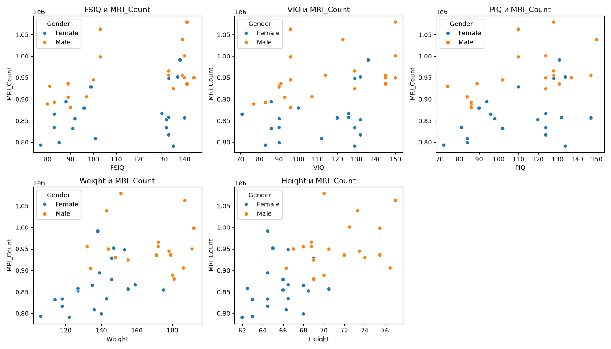
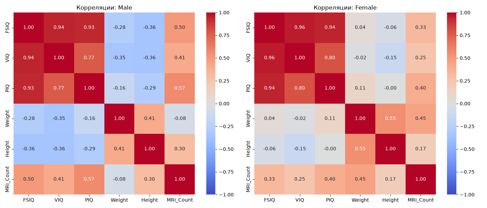

# Лабораторная №2. Pandas и корреляционный анализ

В работе анализируются два датасета: Titanic (агрегаты и пропуски в Pandas) и
brainsize (корреляции Пирсона между размером мозга и другими признаками).
Решение находится в файлах `pandas_tasks.py` и `correlation_tasks.py`.

## 1. Данные и подготовка

### Titanic (`titanic.csv`)

- 891 пассажир, 12 столбцов.
- Пропуски есть в трёх столбцах: `Age` — 177 (около 20 %), `Cabin` — 687
  (около 77 %), `Embarked` — 2. В остальных столбцах пропусков нет.
- Пассажиров по классам: 1-й класс — 216, 2-й — 184, 3-й — 491.
- Пропуски возраста не заменялись нулём или средним: функции `mean()` и
  сравнение `Age > 30` просто их не учитывают. Если бы пропуски были заменены
  нулями, средний возраст получился бы заниженным.

### brainsize (`brainsize.txt`)

- 40 человек: 20 мужчин и 20 женщин. Столбцы: `Gender`, `FSIQ`, `VIQ`, `PIQ`,
  `Weight`, `Height`, `MRI_Count`.
- Файл читается с разделителем табуляция (`sep="\t"`), а `NA` распознаётся как
  пропуск (`na_values="NA"`).
- Пропуски есть только у мужчин: в `Weight` — 2, в `Height` — 1. При подсчёте
  корреляции строки с пропуском в паре признаков исключаются автоматически,
  поэтому для мужчин корреляция с весом считается по 18 наблюдениям, а с ростом
  по 19. У женщин везде по 20 наблюдений.

## 2. Методы

### Часть 1 (Titanic)

1. Таблица загружается через `pd.read_csv`.
2. Пропуски по столбцам: `df[столбец].isna().sum()`.
3. Старше 30 лет: сравнение `df["Age"] > 30`, затем подсчёт `True`.
4. Средний возраст по классам: `df.groupby("Pclass")["Age"].mean()`.
5. Доля выживших по классам: `df.groupby("Pclass")["Survived"].mean()`. Так как
   `Survived` принимает значения 0 и 1, среднее равно доле выживших.
6. Пять наибольших тарифов: сортировка `Fare` по убыванию и первые пять.

### Часть 2 (корреляции)

1. Данные разделяются на мужчин (`Gender == "Male"`) и женщин
   (`Gender == "Female"`).
2. В каждой группе для признаков `FSIQ`, `VIQ`, `PIQ`, `Weight`, `Height`
   считается коэффициент корреляции Пирсона с `MRI_Count`
   (`Series.corr`, метод по умолчанию — Пирсон).
3. Признак с максимальным модулем корреляции ищется среди результатов обеих
   групп; сам `MRI_Count` в поиск не входит.
4. Для себя построены scatter-графики (каждый признак против `MRI_Count`,
   цветом выделен пол) и тепловые карты корреляций по группам. Код —
   `correlation_plots.py`.

## 3. Результаты

### Titanic

| Показатель | Значение |
|---|---|
| Число пассажиров | 891 |
| Пропусков в `Age` / `Cabin` / `Embarked` | 177 / 687 / 2 |
| Пассажиров старше 30 лет | 305 |

| Класс | Средний возраст | Доля выживших |
|---|---|---|
| 1 | 38.23 | 0.6296 |
| 2 | 29.88 | 0.4728 |
| 3 | 25.14 | 0.2424 |

Пять наибольших тарифов (по убыванию): 512.3292, 512.3292, 512.3292, 263.0,
263.0.

### Корреляции с `MRI_Count`

| Признак | Мужчины (r) | Женщины (r) |
|---|---|---|
| FSIQ | 0.4984 | 0.3257 |
| VIQ | 0.4131 | 0.2549 |
| PIQ | **0.5682** | 0.3962 |
| Weight | −0.0769 | 0.4463 |
| Height | 0.3015 | 0.1745 |

Количество наблюдений: мужчин 20, женщин 20.
Признак с максимальным модулем корреляции: **PIQ** (у мужчин, r = 0.5682).

Графики:

## 4. Выводы

**Titanic.**

1. Чем выше класс, тем старше пассажиры (в среднем 38.2, 29.9 и 25.1 года для
   1, 2 и 3 класса) и тем выше доля выживших (63 %, 47 % и 24 %). Выжившие
   в 1-м классе составляют почти две трети, а в 3-м менее четверти.
2. Это только описание данных: из таблицы нельзя сделать вывод о причинах.
   Класс, возраст и выживание могут быть связаны между собой, и по этим
   агрегатам нельзя понять, что на что влияет.
3. Возраст неизвестен у 177 пассажиров, поэтому среднее и число людей старше
   30 лет считаются только по пассажирам с известным возрастом. Реальное
   значение для всех пассажиров может отличаться.
4. Значение 512.3292 встречается трижды: несколько пассажиров заплатили один и
   тот же максимальный тариф.

**Корреляции.**

1. У обеих групп размер мозга положительно связан с показателями
   интеллекта (FSIQ, VIQ, PIQ), но связь умеренная: коэффициенты от 0.25 до 0.57.
2. У мужчин самая сильная связь с PIQ (0.57), а затем с FSIQ (0.50) и VIQ
   (0.41). У женщин самая сильная связь с весом (0.45), а затем с PIQ (0.40).
3. Признак с наибольшим модулем корреляции среди обеих групп — PIQ.
4. Связь с весом у мужчин и женщин разная: у мужчин она почти нулевая
   (−0.08), у женщин умеренная (0.45). Различие может быть реальным, но может
   объясняться малой выборкой и пропусками (у мужчин вес известен лишь у 18
   из 20).
5. Выборка очень мала: по 20 человек в группе. Для проверки я посчитал
   p-значения (`scipy.stats.pearsonr`): при уровне 0.05 значимыми получились
   только три связи: мужчины PIQ (p = 0.009) и FSIQ (p = 0.025), женщины Weight
   (p = 0.049). Остальные нельзя отличить от случайных. Но проверялось сразу
   десять связей, поэтому среди них по случайности могут оказаться «значимые»,
   и выводы нужно считать предварительными.
6. Коэффициент Пирсона измеряет только линейную связь и не доказывает
   причинно-следственную зависимость. Например, размер мозга и вес оба могут
   зависеть от общего роста человека.

## 5. Воспроизводимость

- Все результаты детерминированы (случайных чисел в работе нет).
- Тесты: `python -m pytest -v` (10 проверок в `test_lab2.py`).
- Графики: `python correlation_plots.py` (создаёт `scatter.png` и
  `heatmap.png`).
- Окружение: Python 3.15.0, pandas 3.0.6, numpy 2.5.4, matplotlib 3.11.2, seaborn 0.13.2, scipy 1.18.1